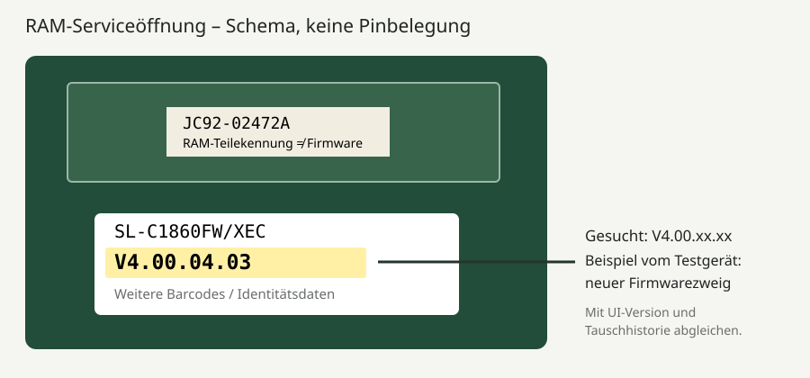

# Welche C1860FW-Firmware passt? Zwei Displaygenerationen

**Der Modellname C1860FW allein reicht nicht aus.** Samsung hat innerhalb dieses
Modells die OPE geändert. OPE bezeichnet die Bedienfeld-/Displayeinheit. Die
Firmwarelinien enthalten unterschiedliche Displaykernel, Treiber und teilweise
Bootloader. Sie sind keine beliebig austauschbaren Versionsstände.

Die `.04.06`-Release-Notes dokumentieren bei `.03.02` den Hardwarewechsel und
die fehlende Austauschbarkeit. Die `.02.50`-Hinweise unterscheiden ebenfalls
die Zweige. Beide PDFs liegen in den originalen
[Hersteller-ZIPs](ANLEITUNG.md#2-die-passende-originalfirmware-herunterladen).

## Erkennungsmerkmale vergleichen

| Merkmal | Alte Displaygeneration | Neue Displaygeneration |
| --- | --- | --- |
| Untersuchte Originaldatei | `SL1860FW_V4.00.02.50.hd` | `SL1860FW_V4.00.04.06.hd` |
| Systemversion dieses Pakets | `V4.00.02.50` | `V4.00.04.06` |
| Zugehörige UI-Version | `V5.08.51.05 07-04-16` | `V5.08.20.03 25-05-16` |
| Weiterer belegter UI-Stand | `.51.01` aus älterem C1860FW-Dateisystembackup | `.20.02` vor dem Update des Testgeräts |
| Plattform im Displaypaket | TI OMAP3-Familie | Nexell NXP2120 |
| Kernel im Displaypaket | `2.6.32.002` | `2.6.32.13` |
| Factory-Aufkleber dieses Projekts | Kein Foto einer alten Variante | `SL-C1860FW/XEC`, darunter `V4.00.04.03` |
| SMB-Patch-Teststatus | **Am Gerät UNGETESTET** | **An einem Gerät getestet** |

**UI `.51` ist hier nicht „neuer und besser“ als `.20`.** Die Nummern gehören
zu verschiedenen Displaylinien. Kaufdatum, Download-Datum, Region wie XEC/XAA
und die äußerlich gleiche Modellbezeichnung bestimmen den Zweig nicht sicher.

## 1. Wenn der Drucker funktioniert: System und UI auslesen

1. SyncThru im Browser öffnen und als Administrator anmelden.
2. **Wartung → Firmware-Upgrade** öffnen.
3. **Systemversion und UI-Version gemeinsam** notieren.
4. Tabelle und Hersteller-Release-Notes abgleichen.

Das Testgerät kam mit `.04.03` / `.20.02`. Zuerst wurde das unveränderte
`.04.06`-Paket installiert; danach zeigte es `.04.06` / `.20.03`.

Bei einer alten `.02.xx`-/`.51.xx`-Kombination niemals einfach `.04.06` wählen,
weil die Nummer größer ist. Bei unbekannten oder widersprüchlichen Kombinationen
ist die Zuordnung **nicht sicher geklärt**. Der Offline-Patcher erkennt eine
Datei, nicht die physische Druckerhardware.

## 2. Factory-Aufkleber hinter dem RAM-Türchen

Am Testgerät war ein Aufkleber auf der Hauptplatine durch die RAM-Serviceöffnung
sichtbar. Modellcode und **`V4.00.04.03`** belegen den Auslieferungsstand dieses
Exemplars und liefern einen zusätzlichen Hinweis auf den neueren Zweig.

Falls diese zugängliche Serviceklappe an deinem Gerät vorhanden ist:

1. Drucker normal ausschalten und Netzstecker ziehen.
2. Nur die vorgesehene RAM-Serviceklappe öffnen. Zum Lesen keine Platinen,
   Kabel oder Speichermodule ausbauen.
3. Nach dem **Hauptplatinen-Aufkleber mit Modellcode und einer Version im
   Format `V4.00.xx.xx`** suchen. Am Testgerät lag er unterhalb des RAM-Moduls.
4. Nicht mit dem RAM-Aufkleber verwechseln: `JC92-02472A` ist eine Teilekennung,
   `20160602` ein Datum; beides ist keine Firmwareversion.
5. Firmwareversion abschreiben. Bei öffentlichen Fotos MAC-Adresse,
   Seriennummern und Barcodes abdecken.
6. Klappe vor dem Einschalten wieder schließen.

Das Schema ist kein Foto und keine Aussage über jede Platinenrevision. Ein
Softwareupdate erneuert den Aufkleber nicht. Nach Hauptplatinen-/Displaytausch
kann er von der tatsächlich eingebauten Kombination abweichen. Der Aufkleber
ist ein **Indiz**, kein alleiniger Kompatibilitätsnachweis.

## 3. Wenn bereits eine falsche Firmware installiert wurde

Die Weboberfläche kann eine neu geschriebene Systemversion anzeigen, obwohl
das vorhandene Display zur anderen Generation gehört oder nicht mehr startet.
**Dann darf die aktuelle Systemnummer nicht allein das nächste Paket bestimmen.**

Hilfreich sind frühere System-/UI-Werte, der ursprüngliche Aufkleber, bekannte
Tauschhistorie und eine fachkundige OPE-Identifikation. Wenn diese Belege nicht
zusammenpassen: nicht weiter auf Verdacht flashen.

## Kann man ein kaputtes Gerät wieder retten?

Ein [Reparaturbericht im ElektronikForumet](https://elektronikforumet.com/forum/viewtopic.php?start=15&t=105114)
beschreibt ein nach einem Firmwareupdate ausgefallenes **C1860FW mit älterer
OMAP-Displaylinie**: Wiederherstellung über serielle Konsole und passendes
Dateisystembackup. Im selben Thread beschreibt ein anderer Autor eine
**CLX-6260FW**-Reparatur mit externem SD-Dateisystem und zum Kernel passenden Treibern.

Das ist eine Reparaturmöglichkeit unter passenden Voraussetzungen, **keine
allgemeine C1860FW-Recovery-Anleitung** und kein Nachweis einer reinen
Netzwerkrettung für die neuere Nexell-Platine. Die alten Forumsbackups sind
weder ein vollständiger Dump deines Druckers noch ein Universalimage.
Bootloader-, Treiber- oder NAND-Schäden können Hardwarezugriff erfordern.

Dieses Repo verteilt keine fremden NAND-Dumps und keine pauschalen
U-Boot-Flashbefehle. **Die richtige Generation vor dem Update bestimmen ist
besser als auf eine ungesicherte Recovery zu hoffen.**
