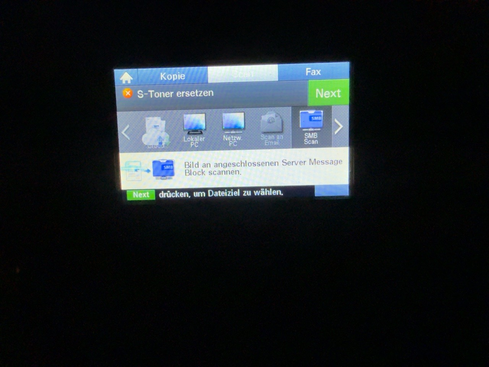
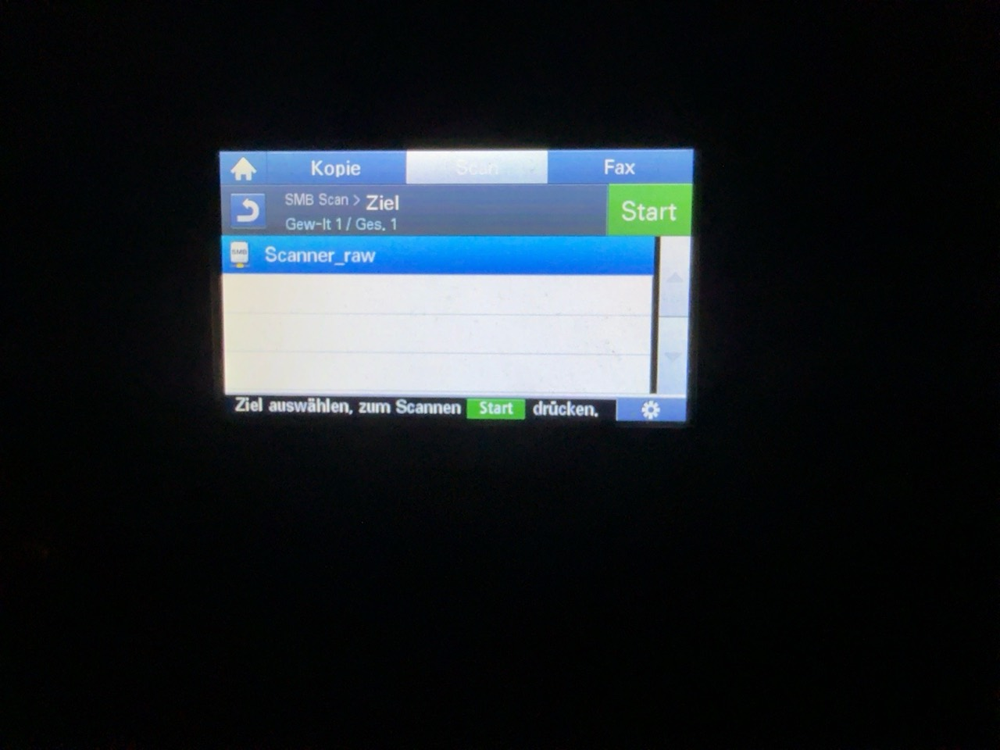
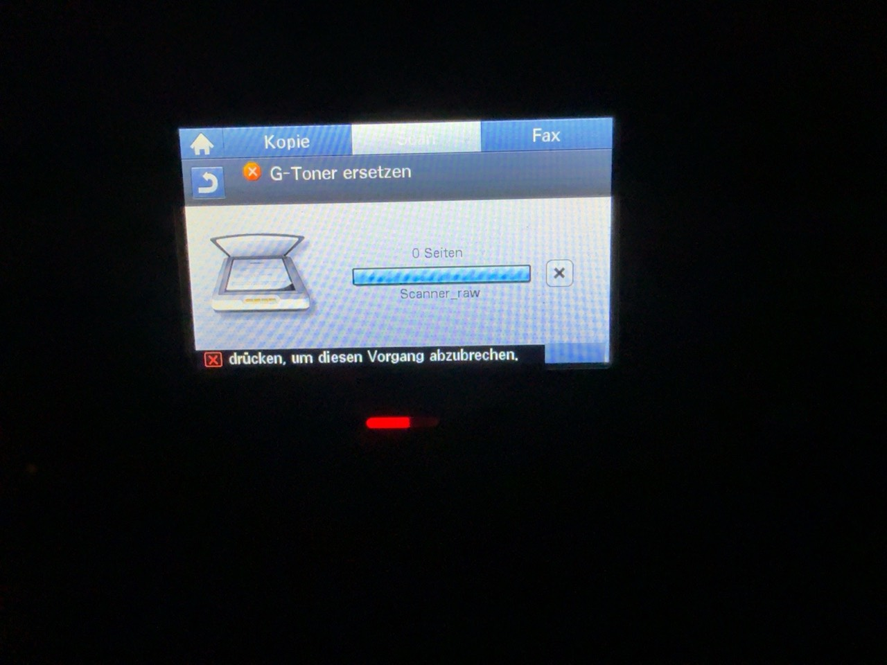

# Verification and test status

## Hardware result: V4.00.04.06 / UI V5.08.20.03

On 25 October 2026, one owned Samsung Xpress C1860FW completed this sequence:

1. Its original system was V4.00.04.03, with UI V5.08.20.02.
2. The unchanged official V4.00.04.06 package was installed using the normal
   SyncThru firmware wizard. After automatic restart, the reported versions
   were system V4.00.04.06, UI V5.08.20.03, network V4.01.62.
3. The SMB-patched `.04.06` package passed the normal wizard's verification and
   installation flow. The wizard detected the automatic restart and completed.
4. The owner photographed the newly selectable native **SMB Scan** menu and
   the selected saved SMB favorite, then started the scan at the touchscreen.
5. A new **473,120-byte `Scan.pdf`** was independently observed on the NAS SMB
   destination, with PDF header/EOF markers. No API scan job was submitted for
   this test, and no scan-relay service was installed.

The documented successful destination used guest access. Other NAS brands,
credential modes, ADF/multipage workflows and scan formats have not all been
validated by this test. It proves this particular native display-to-SMB path,
not every scan feature or compatibility with arbitrary firmware variants.

The public patcher reproduces the installed full-image hash exactly. The
installed GUI was not independently dumped back from the printer.





The scan document, LAN addresses, printer serial/MAC, admin credentials and
configuration backups are deliberately not published.
Photo EXIF/IPTC metadata was removed without recompressing the JPEG image data.

## Offline-only result: V4.00.02.50 / UI V5.08.51.05

**No physical printer has been flashed or scanned with this profile as part of
this project.** It must not be described as working on hardware.

The exact manufacturer input was inspected; both gates and corresponding
patched control flows were checked in Ghidra. The public patcher generated the
full image and verified component preservation, root TAR differences, MD5
fields, payload lengths and UI checksum. The original bootloader component
remains included. The resulting output SHA-256 is an offline reference, not
proof of device acceptance or recovery.

## Automated tests

Run from the repo root:

```sh
python3 -m unittest discover -s tests -v
```

The tests construct small synthetic firmware containers, not copies of vendor
firmware. They verify both data integrity and refusal conditions. CI runs the
same suite on Windows, macOS and Linux with Python 3.10 and 3.14. Full official
images are not downloaded or flashed by CI. The graphical front end and OS
launchers require user testing; passing core tests is not a claim of having
tested the GUI on every operating system.

## Reproducing full-image verification locally

With an original supported `.hd` obtained separately:

```sh
python3 patcher.py /path/to/original.hd --inspect
python3 patcher.py /path/to/original.hd --output /new/path/checked_SMB.hd
```

For `.02.50`, explicitly add `--allow-untested`. The JSON report and
[profile reference](firmware-profiles.json) provide expected hashes.
The output and report must not already exist. Re-running the patcher on a
patched output should be refused.

## Reporting another hardware result

Include the exact model, system/UI versions before and after, original and
output SHA-256, installation method, whether SMB appeared and was selectable,
and whether a display-initiated scan actually arrived. State guest vs. named
login, NAS platform, flatbed vs. ADF, and format if known. Redact credentials,
private addresses, serial numbers and document content. Do not attach firmware
or full configuration exports.
